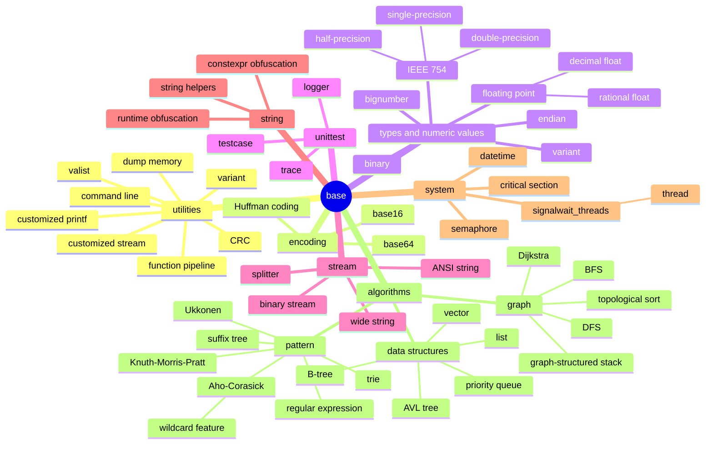

## Publication

```text
┌──────────────────────────────────────────────┐
│ hotplace source tree                         │
│ Edition 2 · Revision 1105                    │
│ Source basis: Revision 1105                  │
│ Documented with GPT-6                        │
│ Documentation scope: directory identity and  │
│ implementation navigation                    │
└──────────────────────────────────────────────┘
```

# Base SDK

## 1. Role

`sdk/base` contains reusable low-level facilities shared by higher-level hotplace modules. Its contents include value and byte representations, encoders, data structures and algorithms, in-memory streams and strings, operating-system-adjacent helpers, and the test/logging support used by the project's own test programs.

The directory is a foundation layer rather than a protocol implementation. TLS, QUIC, ASN.1, HTTP, and other higher-level modules may use its primitives, but protocol rules and wire-message sequencing belong to those higher layers.

The directory map below preserves the original topic map as a navigation aid. It is a conceptual inventory, not a claim that every item has the same dependency direction or is implemented in one common framework.

## 2. Model

### Directory map



### How to read this map

The map groups facilities by their primary topic; the concrete implementation is distributed across subdirectories and individual headers/sources.

- `basic` contains general helpers such as `variant`, `valist`, `function_pipeline`, `cmdline`, `dump_memory`, and CRC support.
- `encoding` contains byte/text encoding facilities. These are distinct from the generic value representation in `basic`.
- `stream` and `string` provide in-memory formatting, buffering, and string-oriented operations. They are not interchangeable with the OS-backed adapters in `sdk/io`.
- `system` contains synchronization, time, and thread-related helpers whose implementation may depend on the target platform.
- data structures, pattern matching, and graph algorithms provide reusable algorithms; the GLR parser's graph-structured stack is a specialized consumer of graph-shaped storage.
- `unittest` is infrastructure for hotplace's own tests, not an application-level testing framework dependency imposed on every SDK consumer.

### Topic documents retained from the original README

- [Compile-time string obfuscation](string/constexpr-obfuscation.md)
- [Big-number notes](system/bignumber.md)

These links are retained as topic-specific documents; the README does not replace their implementation-level explanations.

## 3. Important behavior and lifetime

### Layer boundaries

`base` provides primitives and reusable mechanisms. It should not be read as a single unified runtime object model: a `variant`, a `basic_stream`, a graph, and a synchronization helper have different ownership and lifetime rules.

When following a call from a higher-level module, distinguish among:
1. the base primitive that stores or transforms data;
2. the higher-level component that assigns protocol or application meaning to it; and
3. the test harness that records the expected result.

For example, `dump_memory` formats bytes for diagnostics; it does not validate a protocol message. `variant` can represent protocol-width integers; it does not itself define the wire protocol. A graph algorithm computes traversal/order results; the consuming parser decides what those results mean.

### Compatibility and platform-sensitive areas

The project targets C++11 as its general baseline. Some isolated experiments, such as compile-time string obfuscation, may use newer language features and should not be interpreted as a promise of broad C++14-or-later support.

Platform-sensitive code deserves direct inspection rather than assumptions based on the directory name. `valist` reconstructs ABI-specific argument representations, and synchronization, thread, and console facilities can vary by compiler/OS.

### Verification boundary

Source examples and testcase reports answer different questions. A source-level test explains what the test attempts to check; a report records an execution result for a particular report snapshot. Unless a report explicitly identifies the source revision and environment, it should not be used as proof that the exact current working tree passed on a particular platform.

## 4. Example from the source tests

### Follow one value through the base utilities

The `variant` and `valist` tests show how a typed value can move through several base-level representations without introducing protocol semantics:

```text
testcase_variant.cpp
    │
    ├── variant::set(...)
    ├── variant::to_binary(...)
    └── base16_encode(...) ──► expected hexadecimal bytes

testcase_valist.cpp
    │
    ├── valist::operator<<(...)
    ├── sprintf(..., valist)
    └── basic_stream ─────────► expected formatted text
```

In `test/testcase/base/basic/testcase_variant.cpp`, the test sets a `uint32` value, converts it to binary with the selected endian/truncation flags, and compares the Base16 result with `"00008000"`. The same testcase checks a 64-bit value and a `bignumber` conversion. This is a concrete path from typed value to bytes to a readable test expectation.

In `test/testcase/base/basic/testcase_valist.cpp`, values are appended to a `valist` and passed to the project's formatting interface. The test compares the resulting `basic_stream` text with an expected string. This demonstrates the integration path; it does not make native `va_list` layouts portable.

### Where to continue

- [`variant` testcase](../../test/testcase/base/basic/testcase_variant.cpp) — typed values, binary conversion, and conversion expectations.
- [`valist` testcase](../../test/testcase/base/basic/testcase_valist.cpp) — dynamically assembled formatting arguments.
- [`dump_memory` testcase](../../test/testcase/base/basic/testcase_dumpmemory.cpp) — formatting raw bytes with different widths, indentation, and display-base options.
- [`graph` testcase](../../test/testcase/base/graph/testcase_graph.cpp) — graph traversal and shortest-path algorithms.

The test sources are executable examples to inspect; their presence alone is not a statement that they were run in every supported environment.

## 5. Relationships

```text
             higher-level hotplace modules
        (protocols, parsers, crypto, applications)
                         │
                         ▼
                 reusable sdk/base
       ┌──────────┬───────────┬───────────┐
       │ values   │ algorithms│ I/O-like  │
       │ encoding │ data      │ in-memory │
       │ types    │ structures│ helpers   │
       └──────────┴───────────┴───────────┘
                         │
                         ▼
             platform / standard library
```

This is a conceptual dependency direction, not a complete include graph. Individual dependencies should be confirmed in the relevant source files.

- `sdk/base/stream` is for in-memory stream and buffer operations; `sdk/io/stream` adapts stream behavior to external I/O.
- `sdk/base/unittest` uses logging to make test execution and diagnostic output observable.
- `sdk/base/graph/gss.hpp` is a graph-shaped stack used by `sdk/io/parser/glr_parser.cpp`; parser semantics remain in the parser layer.
- `sdk/base/basic/variant.hpp` supplies generic value representation used by facilities such as `valist`.

## 6. References

### Books

- *Data Structures and Algorithm Analysis in C++*
  - Binary search trees: §4.3, “The Search Tree ADT – Binary Search Trees”
  - Lists and vectors: Chapter 3, “Lists, Stacks, and Queues”
  - KMP: §12.3.3, “The Knuth-Morris-Pratt Algorithm”
  - Priority queues: Chapter 6, “Priority Queues (Heaps)”
- *Data Structures and Algorithms in C++*

### RFC

- [RFC 4648 — The Base16, Base32, and Base64 Data Encodings](https://www.rfc-editor.org/rfc/rfc4648)

### Articles and online resources

- Dynamic `va_list` discussion: https://stackoverflow.com/questions/11695237/creating-va-list-dynamically-in-gcc-can-it-be-done
- Aho-Corasick:
  - https://www.javatpoint.com/aho-corasick-algorithm-for-pattern-searching-in-cpp
  - Failure links and output: https://daniel.lawrence.lu/blog/y2014m03d25/
- Dijkstra: https://en.wikipedia.org/wiki/Dijkstra%27s_algorithm
- Graph visualization: https://graphonline.ru/en/
- Pattern-matching overview: https://www.geeksforgeeks.org/
- Suffix tree:
  - https://www.geeksforgeeks.org/pattern-searching-using-trie-suffixes/
  - Ukkonen animation: https://brenden.github.io/ukkonen-animation/
  - https://programmerspatch.blogspot.com/2013/02/ukkonens-suffix-tree-algorithm.html
  - https://www.geeksforgeeks.org/ukkonens-suffix-tree-construction-part-1/
- Trie:
  - https://www.geeksforgeeks.org/trie-data-structure-in-cpp/
  - https://www.geeksforgeeks.org/auto-complete-feature-using-trie/
- Wildcard matching: https://www.geeksforgeeks.org/wildcard-pattern-matching/
- Big-number calculator: https://www.calculator.net/big-number-calculator.html
- IEEE 754 and floating-point:
  - https://en.wikipedia.org/wiki/IEEE_754
  - https://en.wikipedia.org/wiki/Floating-point_arithmetic
  - https://en.wikipedia.org/wiki/Half-precision_floating-point_format
  - https://en.wikipedia.org/wiki/Single-precision_floating-point_format
  - Goldberg's floating-point article: https://docs.oracle.com/cd/E19957-01/806-3568/ncg_goldberg.html
  - Cambridge lecture slides: https://www.cl.cam.ac.uk/teaching/1011/FPComp/fpcomp10slides.pdf
  - https://www.youtube.com/watch?v=8afbTaA-gOQ
  - https://www.corsix.org/content/converting-fp32-to-fp16
  - https://blog.fpmurphy.com/2008/12/half-precision-floating-point-format_14.html
- IEEE 754 converters:
  - https://www.h-schmidt.net/FloatConverter/IEEE754.html
  - https://baseconvert.com/ieee-754-floating-point
  - https://www.omnicalculator.com/other/floating-point

## 7. Developer Notes (for maintainer review)

### C++ Standard and GCC notes retained from the original README

The following table is preserved as a historical maintainer note. It records the standard labels and approximate GCC versions from the original document; it is not a current compatibility guarantee and should be revalidated before being used as a support matrix.

| C++ label in original note | GCC version noted | Original reference |
|---|---:|---|
| c++0x | 4.3+ | — |
| c++11 | 4.7+ | https://en.cppreference.com/w/cpp/compiler_support/11 |
| c++1y | 4.8+ | — |
| c++14 | 5.1+ | https://en.cppreference.com/w/cpp/compiler_support/14 |
| c++1z | 6.1+ | — |
| c++17 | 7.1+ | https://en.cppreference.com/w/cpp/compiler_support/17 |
| c++2a | 8.1+ | — |
| c++20 | 10.1+ | https://en.cppreference.com/w/cpp/compiler_support/20 |
| c++23 | 11.1+ | https://en.cppreference.com/w/cpp/compiler_support/23 |

Additional original reference: https://gcc.gnu.org/projects/cxx-status.html

The project-wide intention is C++11 compatibility. Newer-standard experiments should remain clearly isolated and should not be used to imply that the entire SDK has moved to a newer baseline.
