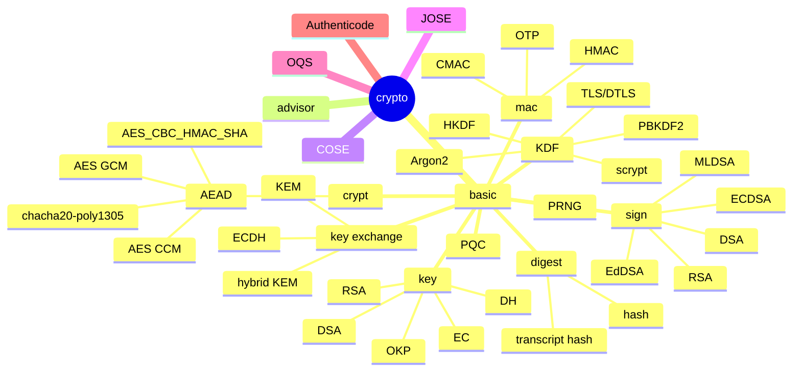

## Publication

```text
┌──────────────────────────────────────────────┐
│ hotplace source tree                         │
│ Edition 1 · Revision 1105                    │
│ Source basis: Revision 1105                  │
│ Documented with GPT-6                        │
│ — source structure, implementation & tests   │
└──────────────────────────────────────────────┘
```
# Crypto Mindmap

## 1. Role

This mindmap is a navigation aid for the cryptographic subsystem: primitive operations and key objects are grouped under `basic`, metadata lookup under `advisor`, and protocol/format integrations under COSE, JOSE, OQS, and Authenticode. The diagram summarizes topic relationships, not a class inheritance graph or a guarantee that every listed algorithm is enabled.

## 2. Data Model
#### crypto



## 3. Behavior Model
The `basic` layer implements or adapts cryptographic operations; the advisor layers map identifiers and metadata; COSE/JOSE add message-format semantics; OQS provides post-quantum provider integration; Authenticode performs PE-specific signature verification. These layers have different responsibilities and should not be collapsed into one generic crypto API.

## 4. Relationships

### Module relationships

### Source-test evidence

Representative source paths include `test/testcase/crypto/crypt/` for ciphers/AEAD, `test/testcase/crypto/hash/` for digests/MAC/transcript hashes, `test/testcase/crypto/key/` for key objects/generation/exchange, `test/testcase/crypto/sign/` for signatures, and the COSE/JOSE testcase directories for format-level processing. Their presence identifies source coverage only; this documentation update did not execute them.

- [`basic/`](basic/README.md) — primitive operations, key objects, KDF, digest/MAC and signatures
- [`advisor/`](advisor/README.md) — metadata and identifier lookup
- [`cose/`](cose/README.md) and [`jose/`](jose/README.md) — format-specific message processing
- [`oqs/`](oqs/README.md) — post-quantum provider adapter
- [`authenticode/`](authenticode/README.md) — Windows PE Authenticode verification
