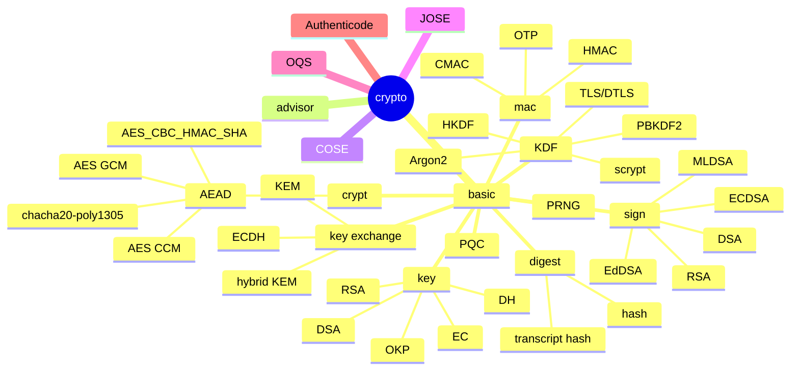

## Publication

```text
┌──────────────────────────────────────────────┐
│ hotplace source tree                         │
│ Edition 1 · Revision 1104                    │
│ Documented with GPT-6                        │
│ — source structure, implementation & tests   │
└──────────────────────────────────────────────┘
```
# Crypto Mindmap

## 1. Role

This document identifies the module or reference topic represented by this file.

## 2. Model

#### crypto



## 3. Important behavior and lifetime

Implementation behavior is documented only to the extent supported by the retained notes and source references.

## 4. Example from the source tests

See the referenced testcase source files for concrete examples. A source reference alone does not prove runtime execution.

## 5. Relationships

Related implementation modules and protocol boundaries are recorded here where identified.

## 6. References

Relevant source paths, sibling documentation, and standards references are retained here where available.
