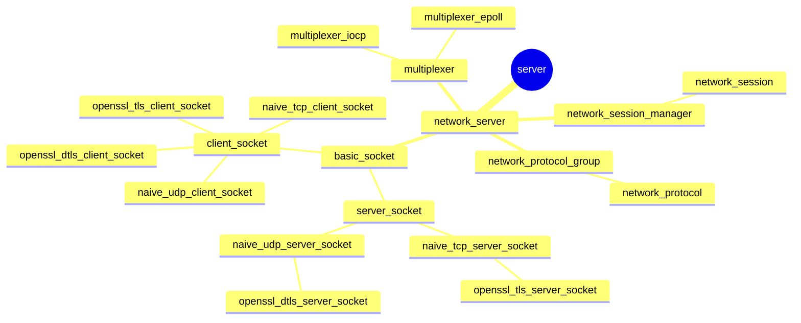

## Publication

```text
┌──────────────────────────────────────────────┐
│ hotplace source tree                         │
│ Edition 1 · Revision 1104                    │
│ Documented with GPT-6                        │
│ — source structure, implementation & tests   │
└──────────────────────────────────────────────┘
```
# Server mindmap

## 1. Role

This document identifies the module or protocol area represented by this file.

## 2. Model



## 3. Important behavior and lifetime

Implementation details and behavior are described where the existing source-tree notes provide evidence.

## 4. Example from the source tests

See the referenced testcase sources for concrete examples. Where no direct test is identified, this is not evidence of runtime verification.

## 5. Relationships

Related implementation areas and protocol boundaries are recorded here where identified.

## 6. References

Source references and related documents are retained here where available.
