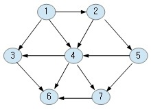
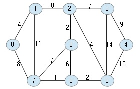
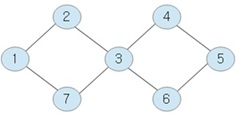
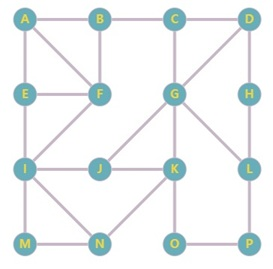

## Publication

```text
hotplace source tree
Edition 2 · Revision 1106
Source basis: Revision 1106
Documented with GPT-6
— source structure, implementation & tests
```

# Graph and graph-structured stack testcases

## 1. What

The directory exercises two related but different models from [`sdk/base/graph`](../../../../sdk/base/graph/README.md):

- `t_graph<T>` represents a graph whose vertices carry values of `T`. The tests build directed and undirected graphs, then invoke adjacency traversal, DFS, BFS, Dijkstra shortest-path traversal, and topological sorting.
- `t_gss<STATE, VALUE>` represents a graph-structured stack (GSS). It retains multiple parent links when paths fork and later merge. The tests explicitly build shared ancestry, traverse nodes, and reconstruct paths.

The GSS tests are relevant to parser ambiguity handling; they should not be read as another set of ordinary graph-search tests.

## 2. How

### 2.1 Adjacency, DFS, and BFS

1. In [`testcase_graph.cpp`](testcase_graph.cpp), `do_test_graph()` builds each search object using `build_adjacent()`, `build_dfs()`, or `build_bfs()`, then calls `learn().infer()`. For each algorithm, the helper traverses once without a specified start and once from the supplied start vertex. The callback prints the source vertex and the returned list, using comma-separated values.

2. The graph shapes used by `test_graph1()` are shown directly below. The same fixtures are reused by traversal and shortest-path examples, so the diagrams make the adjacency and possible route choices easier to see than a textual edge inventory.

**`g` — directed graph**



**`g2` — weighted undirected graph**



**`g3` — undirected graph with alternative routes**



**`g4` — letter-labelled undirected graph**



The string graph in `test_graph2()` is a separate activity-schedule example, with edges weighted in minutes or hours.

3. The current helper ends every traversal with `assert(true, ...)`. Those calls do not compare visited vertices, ordering, or adjacency contents against expected lists. The examples therefore show that the traversal methods are invoked across several graph shapes and provide diagnostic output, but they do not independently verify DFS/BFS/adjacency correctness.

### 2.2 Dijkstra shortest paths

1. The shortest-path helper similarly builds the Dijkstra object, calls `learn().infer()`, and invokes either `traverse(start, handler)` or `traverse(start, end, handler)`. The callback prints the source, destination, path, and reported distance.

2. The path output below is paired with the graph used to produce it. In `test_graph1()`, `g` is the directed-edge example; `g2` is the weighted graph with vertices `0`–`8`; `g3` shows a cyclic graph with multiple equal-length routes; and `g4` is the letter-labelled graph used for the `A`-to-`P` example.

| Test instance | Image | What the path listing illustrates |
|---|---|---|
| `t_graph<int> g` | `directed.jpg` | Directed-edge example; paths are listed from each start vertex. |
| `t_graph<int> g2` | `undirected.jpg` | Weighted, undirected graph; distances reflect edge weights. |
| `t_graph<int> g3` | `alternative.jpg` | Cyclic graph with multiple equal-length routes. |
| `t_graph<char> g4` | `undirected2.jpg` | Letter-labelled graph; the example shows a shortest path from `A` to `P`. |

The helper's final assertion is unconditional. The emitted path and distance are not compared with an expected path or distance, so these cases are diagnostic demonstrations rather than strong shortest-path result checks.

### 2.3 Topological sort: two explicit expected orders

1. The test file checks topological sorting for both an integer graph and the string-labelled activity graph:

- In `test_graph1()`, the expected integer order is `{1, 2, 5, 4, 3, 7, 6}`.
- In `test_graph2()`, the activity graph expects `{"get up", "eat breakfast", "brush teeth (morning)", "go to work", "work", "go home", "shower", "eat dinner", "brush teeth (evening)", "go to bed", "watch tv", "dream"}`.

2. The helper prints the generated list and asserts exact list equality with the supplied expected order. This is stronger than the traversal and Dijkstra helpers because the returned sequence is checked. These are expected orders for the two constructed graphs, not a general proof of cycle detection or all valid topological orders.

### 2.4 Graph-structured stack traversal and retracing

1. In [`testcase_gss.cpp`](testcase_gss.cpp), a small graph is constructed with `Root` as the common ancestor, two branches `A1` and `A2`, and a `Merge` node with both branch nodes as parents.

2. For `traverse_all()`, the test checks that four visits occurred and that each of `Root`, `A1`, `A2`, and `Merge` appeared in the visited-value set. This checks unique node coverage for the sample graph. By contrast, the following `traverse_from()`, `traverse_where()`, and `traverse_by_state()` calls finish with unconditional assertions; their emitted output is not checked against an expected traversal sequence.

3. The retrace tests provide stronger evidence:

- **Linear retrace:** a `Root -> A -> B` parent chain is retraced from `B`; the callback checks path length 3 and the order `B, A, Root`, then the test checks exactly one path was returned.
- **Fork-and-merge retrace:** `Merge` has parents `A1` and `A2`, both descended from `Root`. The callback checks each path starts at `Merge`, ends at `Root`, and has length 3; the test checks that two paths were found. It does not explicitly assert whether the middle element is `A1` or `A2` in each callback.

4. These cases exercise selected shared-parent structures, not every ambiguity shape or arbitrary-depth graph.

## 3. Evidence

### Source-level coverage

**1. Traversal examples**

```text
graph fixture -> learn().infer() -> DFS/BFS callback -> print visited nodes
  -> unconditional assert(true, ...) in selected helpers
  -> no expected order / visited-set comparison
```

**2. Dijkstra**

```text
graph + start/end -> shortest-path traversal -> print path and distance
  -> unless an explicit expected comparison exists in that case,
     output is diagnostic, not a correctness assertion
```

**3. Topological order and GSS**

```text
topological-sort fixture -> sort -> compare returned order == expected sequence

GSS fork/merge fixture -> traverse/retrace -> compare selected nodes/paths
  -> printed links alone are not assertions
```

Coverage is limited to the fixtures and concrete values actually compared. A group report does not upgrade unconditional assertions into path-correctness checks.


The supplied [Test Report Snapshot](../../test-report-status.md) records the `graph<int>`, `graph<std::string>`, and GSS traversal/retrace groups. The report is group-level execution evidence; it does not turn unconditional assertions into checks of the paths printed by the helpers.

The report does not independently identify the tested source revision, OS, compiler, or complete build configuration.


## 4. Relationships

- [`sdk/base/graph/README.md`](../../../../sdk/base/graph/README.md) — graph and GSS implementation models.
- [`sdk/io/parser/glr_parser.cpp`](../../../../sdk/io/parser/glr_parser.cpp) — parser-side use of graph-structured stack ancestry and paths.
- [`../CMakeLists.txt`](../CMakeLists.txt) — testcase source collection.
- [`testcase_graph.cpp`](testcase_graph.cpp) and [`testcase_gss.cpp`](testcase_gss.cpp) — the direct test flows described here.
- [Test Report Snapshot](../../test-report-status.md) — report provenance and interpretation limits.

## 5. References

No external reference is required to explain these testcase flows.

## 6. Developer Notes

The blocks below preserve the printed shortest-path output for the graph instances shown in §2.2. They are illustrative output, not assertions against expected paths: the helper ends with an unconditional assertion.


### **`g` — `directed.jpg`**


```
path[1->2] 1 -> 2 (distance : 1)
path[1->3] 1 -> 3 (distance : 1)
path[1->4] 1 -> 4 (distance : 1)
path[1->5] 1 -> 2 -> 5 (distance : 2)
path[1->6] 1 -> 3 -> 6 (distance : 2)
path[1->6] 1 -> 4 -> 6 (distance : 2)
path[1->7] 1 -> 4 -> 7 (distance : 2)

path[2->3] 2 -> 4 -> 3 (distance : 2)
path[2->4] 2 -> 4 (distance : 1)
path[2->5] 2 -> 5 (distance : 1)
path[2->6] 2 -> 4 -> 6 (distance : 2)
path[2->7] 2 -> 4 -> 7 (distance : 2)
path[2->7] 2 -> 5 -> 7 (distance : 2)

path[3->6] 3 -> 6 (distance : 1)

path[4->3] 4 -> 3 (distance : 1)
path[4->6] 4 -> 6 (distance : 1)
path[4->7] 4 -> 7 (distance : 1)

path[5->3] 5 -> 4 -> 3 (distance : 2)
path[5->4] 5 -> 4 (distance : 1)
path[5->6] 5 -> 4 -> 6 (distance : 2)
path[5->6] 5 -> 7 -> 6 (distance : 2)
path[5->7] 5 -> 7 (distance : 1)

path[7->6] 7 -> 6 (distance : 1)
```

### **`g2` — `undirected.jpg`**


```
path[0->1] 0 -> 1 (distance : 4)
path[0->2] 0 -> 1 -> 2 (distance : 12)
path[0->3] 0 -> 1 -> 2 -> 3 (distance : 19)
path[0->4] 0 -> 7 -> 6 -> 5 -> 4 (distance : 21)
path[0->5] 0 -> 7 -> 6 -> 5 (distance : 11)
path[0->6] 0 -> 7 -> 6 (distance : 9)
path[0->7] 0 -> 7 (distance : 8)
path[0->8] 0 -> 1 -> 2 -> 8 (distance : 14)

path[1->0] 1 -> 0 (distance : 4)
path[1->2] 1 -> 2 (distance : 8)
path[1->3] 1 -> 2 -> 3 (distance : 15)
path[1->4] 1 -> 2 -> 5 -> 4 (distance : 22)
path[1->5] 1 -> 2 -> 5 (distance : 12)
path[1->6] 1 -> 7 -> 6 (distance : 12)
path[1->7] 1 -> 7 (distance : 11)
path[1->8] 1 -> 2 -> 8 (distance : 10)

path[2->0] 2 -> 1 -> 0 (distance : 12)
path[2->1] 2 -> 1 (distance : 8)
path[2->3] 2 -> 3 (distance : 7)
path[2->4] 2 -> 5 -> 4 (distance : 14)
path[2->5] 2 -> 5 (distance : 4)
path[2->6] 2 -> 5 -> 6 (distance : 6)
path[2->7] 2 -> 5 -> 6 -> 7 (distance : 7)
path[2->8] 2 -> 8 (distance : 2)

path[3->0] 3 -> 2 -> 1 -> 0 (distance : 19)
path[3->1] 3 -> 2 -> 1 (distance : 15)
path[3->2] 3 -> 2 (distance : 7)
path[3->4] 3 -> 4 (distance : 9)
path[3->5] 3 -> 2 -> 5 (distance : 11)
path[3->6] 3 -> 2 -> 5 -> 6 (distance : 13)
path[3->7] 3 -> 2 -> 5 -> 6 -> 7 (distance : 14)
path[3->8] 3 -> 2 -> 8 (distance : 9)

path[4->0] 4 -> 5 -> 6 -> 7 -> 0 (distance : 21)
path[4->1] 4 -> 5 -> 2 -> 1 (distance : 22)
path[4->2] 4 -> 5 -> 2 (distance : 14)
path[4->3] 4 -> 3 (distance : 9)
path[4->5] 4 -> 5 (distance : 10)
path[4->6] 4 -> 5 -> 6 (distance : 12)
path[4->7] 4 -> 5 -> 6 -> 7 (distance : 13)
path[4->8] 4 -> 5 -> 2 -> 8 (distance : 16)

path[5->0] 5 -> 6 -> 7 -> 0 (distance : 11)
path[5->1] 5 -> 2 -> 1 (distance : 12)
path[5->2] 5 -> 2 (distance : 4)
path[5->3] 5 -> 2 -> 3 (distance : 11)
path[5->4] 5 -> 4 (distance : 10)
path[5->6] 5 -> 6 (distance : 2)
path[5->7] 5 -> 6 -> 7 (distance : 3)
path[5->8] 5 -> 2 -> 8 (distance : 6)

path[6->0] 6 -> 7 -> 0 (distance : 9)
path[6->1] 6 -> 7 -> 1 (distance : 12)
path[6->2] 6 -> 5 -> 2 (distance : 6)
path[6->3] 6 -> 5 -> 2 -> 3 (distance : 13)
path[6->4] 6 -> 5 -> 4 (distance : 12)
path[6->5] 6 -> 5 (distance : 2)
path[6->7] 6 -> 7 (distance : 1)
path[6->8] 6 -> 8 (distance : 6)

path[7->0] 7 -> 0 (distance : 8)
path[7->1] 7 -> 1 (distance : 11)
path[7->2] 7 -> 6 -> 5 -> 2 (distance : 7)
path[7->3] 7 -> 6 -> 5 -> 2 -> 3 (distance : 14)
path[7->4] 7 -> 6 -> 5 -> 4 (distance : 13)
path[7->5] 7 -> 6 -> 5 (distance : 3)
path[7->6] 7 -> 6 (distance : 1)
path[7->8] 7 -> 8 (distance : 7)
path[7->8] 7 -> 6 -> 8 (distance : 7)

path[8->0] 8 -> 2 -> 1 -> 0 (distance : 14)
path[8->1] 8 -> 2 -> 1 (distance : 10)
path[8->2] 8 -> 2 (distance : 2)
path[8->3] 8 -> 2 -> 3 (distance : 9)
path[8->4] 8 -> 2 -> 5 -> 4 (distance : 16)
path[8->5] 8 -> 2 -> 5 (distance : 6)
path[8->6] 8 -> 6 (distance : 6)
path[8->7] 8 -> 7 (distance : 7)
path[8->7] 8 -> 6 -> 7 (distance : 7)
```

### **`g3` — `alternative.jpg`**


```
path[1->2] 1 -> 2 (distance : 1)
path[1->3] 1 -> 2 -> 3 (distance : 2)
path[1->3] 1 -> 7 -> 3 (distance : 2)
path[1->4] 1 -> 2 -> 3 -> 4 (distance : 3)
path[1->4] 1 -> 7 -> 3 -> 4 (distance : 3)
path[1->5] 1 -> 2 -> 3 -> 4 -> 5 (distance : 4)
path[1->5] 1 -> 2 -> 3 -> 6 -> 5 (distance : 4)
path[1->5] 1 -> 7 -> 3 -> 4 -> 5 (distance : 4)
path[1->5] 1 -> 7 -> 3 -> 6 -> 5 (distance : 4)
path[1->6] 1 -> 2 -> 3 -> 6 (distance : 3)
path[1->6] 1 -> 7 -> 3 -> 6 (distance : 3)
path[1->7] 1 -> 7 (distance : 1)

path[2->1] 2 -> 1 (distance : 1)
path[2->3] 2 -> 3 (distance : 1)
path[2->4] 2 -> 3 -> 4 (distance : 2)
path[2->5] 2 -> 3 -> 4 -> 5 (distance : 3)
path[2->5] 2 -> 3 -> 6 -> 5 (distance : 3)
path[2->6] 2 -> 3 -> 6 (distance : 2)
path[2->7] 2 -> 1 -> 7 (distance : 2)
path[2->7] 2 -> 3 -> 7 (distance : 2)

path[3->1] 3 -> 2 -> 1 (distance : 2)
path[3->1] 3 -> 7 -> 1 (distance : 2)
path[3->2] 3 -> 2 (distance : 1)
path[3->4] 3 -> 4 (distance : 1)
path[3->5] 3 -> 4 -> 5 (distance : 2)
path[3->5] 3 -> 6 -> 5 (distance : 2)
path[3->6] 3 -> 6 (distance : 1)
path[3->7] 3 -> 7 (distance : 1)

path[4->1] 4 -> 3 -> 2 -> 1 (distance : 3)
path[4->1] 4 -> 3 -> 7 -> 1 (distance : 3)
path[4->2] 4 -> 3 -> 2 (distance : 2)
path[4->3] 4 -> 3 (distance : 1)
path[4->5] 4 -> 5 (distance : 1)
path[4->6] 4 -> 3 -> 6 (distance : 2)
path[4->6] 4 -> 5 -> 6 (distance : 2)
path[4->7] 4 -> 3 -> 7 (distance : 2)

path[5->1] 5 -> 4 -> 3 -> 2 -> 1 (distance : 4)
path[5->1] 5 -> 4 -> 3 -> 7 -> 1 (distance : 4)
path[5->1] 5 -> 6 -> 3 -> 2 -> 1 (distance : 4)
path[5->1] 5 -> 6 -> 3 -> 7 -> 1 (distance : 4)
path[5->2] 5 -> 4 -> 3 -> 2 (distance : 3)
path[5->2] 5 -> 6 -> 3 -> 2 (distance : 3)
path[5->3] 5 -> 4 -> 3 (distance : 2)
path[5->3] 5 -> 6 -> 3 (distance : 2)
path[5->4] 5 -> 4 (distance : 1)
path[5->6] 5 -> 6 (distance : 1)
path[5->7] 5 -> 4 -> 3 -> 7 (distance : 3)
path[5->7] 5 -> 6 -> 3 -> 7 (distance : 3)

path[6->1] 6 -> 3 -> 2 -> 1 (distance : 3)
path[6->1] 6 -> 3 -> 7 -> 1 (distance : 3)
path[6->2] 6 -> 3 -> 2 (distance : 2)
path[6->3] 6 -> 3 (distance : 1)
path[6->4] 6 -> 3 -> 4 (distance : 2)
path[6->4] 6 -> 5 -> 4 (distance : 2)
path[6->5] 6 -> 5 (distance : 1)
path[6->7] 6 -> 3 -> 7 (distance : 2)

path[7->1] 7 -> 1 (distance : 1)
path[7->2] 7 -> 1 -> 2 (distance : 2)
path[7->2] 7 -> 3 -> 2 (distance : 2)
path[7->3] 7 -> 3 (distance : 1)
path[7->4] 7 -> 3 -> 4 (distance : 2)
path[7->5] 7 -> 3 -> 4 -> 5 (distance : 3)
path[7->5] 7 -> 3 -> 6 -> 5 (distance : 3)
path[7->6] 7 -> 3 -> 6 (distance : 2)
```

### **`g4` — `undirected2.jpg`**


```
path[A->P] A -> B -> C -> G -> L -> P (distance : 5)
```
